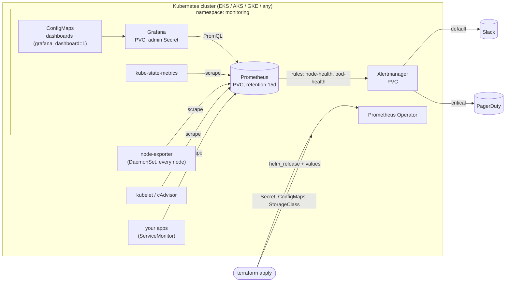

# terraform-k8s-monitoring-stack

[](../../actions/workflows/ci.yml)


A Terraform module that deploys a complete **Prometheus + Grafana + Alertmanager** monitoring stack on **EKS, AKS, GKE** or any Kubernetes cluster. It comes with **pre-configured node & pod health alerts** (unit-tested with promtool), a **"Cluster health" Grafana dashboard**, and **Slack / PagerDuty** routing.

> **Code Clinic – Challenge #21 (Monitoring, Observability & Alerting).**
> *Create a Terraform module that deploys a complete Prometheus + Grafana + Alertmanager stack on EKS/AKS/GKE with pre-configured dashboards and alert rules for node/pod health.*

> 🎓 **New to Prometheus?** Read **[docs/LEARN.md](docs/LEARN.md)**: how scraping, PromQL, rules and Alertmanager fit together, why the module is built this way, a laptop walkthrough, and exercises. Every alert links to a runbook in **[docs/RUNBOOKS.md](docs/RUNBOOKS.md)**.

---

## Table of contents

- [What you get](#what-you-get)
- [Architecture](#architecture)
- [Prerequisites](#prerequisites)
- [Quick start](#quick-start)
- [Usage](#usage)
- [Inputs](#inputs)
- [Outputs](#outputs)
- [Alert rules](#alert-rules)
- [Per-cloud behaviour](#per-cloud-behaviour)
- [Security considerations](#security-considerations)
- [Idempotency notes](#idempotency-notes)
- [Testing](#testing)
- [CI pipeline](#ci-pipeline)
- [Repository layout](#repository-layout)
- [Upgrading the chart](#upgrading-the-chart)

---

## What you get

| | |
|---|---|
| **The full stack** | Prometheus (+ Operator), Alertmanager, Grafana, node-exporter and kube-state-metrics, from the community-standard **kube-prometheus-stack** chart (pinned version) |
| **Cloud-aware defaults** | Right StorageClass per cloud (an encrypted **gp3** class is created on EKS); unreachable managed control-plane targets switched off (no permanent "Down" alerts); GKE Autopilot support |
| **11 node & pod health alerts** | NotReady, pressure, CPU, memory, disk full and filling, crash loops, stuck pods, OOM kills, missing replicas, PVC full. Each has a severity, description and **runbook link**, and they're **unit-tested with promtool**. |
| **Community rules too** | About 150 battle-tested kube-prometheus rules (switchable) |
| **Dashboards** | A custom **"Cluster health (nodes & pods)"** dashboard plus the chart's ~25 standard dashboards. Add your own JSON files with one variable. |
| **Alert routing** | Slack for everything, PagerDuty for critical only; grouping, inhibition, and the Watchdog alert silenced |
| **Secure by default** | Random Grafana admin password in a Secret (no `prom-operator` default); nothing exposed publicly; optional Ingress with TLS; secrets kept out of plan output |
| **Durable** | Persistent volumes for Prometheus, Alertmanager and Grafana; size-based retention so the disk never fills; atomic Helm installs that roll back on failure |
| **Tested** | 15 `terraform test` runs (mocked, no cluster), 6 promtool alert tests, and a full end-to-end install on **kind** in CI |

## Architecture



## Prerequisites

| Requirement | Notes |
|---|---|
| Terraform | `>= 1.7` |
| Providers | `hashicorp/helm >= 2.12, < 3.0`, `hashicorp/kubernetes >= 2.23`, `hashicorp/random`, configured to reach your cluster (see `examples/`) |
| Cluster | Kubernetes 1.27+; about 2 vCPU / 4 GiB free for the stack (more on big clusters) |
| EKS only | The **Amazon EBS CSI driver** add-on (for persistent volumes) |
| Access | Cluster-admin for the identity running Terraform (the chart installs CRDs and cluster roles) |

## Quick start

**On your laptop (kind):**

```bash
kind create cluster --name monitoring
cd examples/kind && terraform init && terraform apply
terraform output -raw grafana_admin_password
kubectl -n monitoring port-forward svc/monitoring-stack-grafana 3000:80   # http://localhost:3000, user admin
```

**On EKS / AKS / GKE:** go to `examples/eks`, `examples/aks` or `examples/gke`, copy `terraform.tfvars.example` to `terraform.tfvars`, fill it in, then run `terraform init && terraform apply`. Pass the Slack webhook as an environment variable rather than in a file:

```bash
export TF_VAR_slack_webhook_url="https://hooks.slack.com/services/..."
```

## Usage

```hcl
module "monitoring" {
  source = "github.com/ngems1/terraform-k8s-monitoring-stack?ref=v1.0.0"

  cloud_provider = "eks"          # eks | aks | gke | generic
  cluster_name   = "prod-eks"     # shows up in every alert

  prometheus_retention    = "30d"
  prometheus_storage_size = "100Gi"
  prometheus_replicas     = 2     # high availability

  slack_webhook_url     = var.slack_webhook_url      # all alerts
  pagerduty_routing_key = var.pagerduty_routing_key  # critical alerts only

  additional_rule_files      = ["${path.root}/monitoring/payments.rules.yaml"]
  additional_dashboard_files = ["${path.root}/monitoring/payments.json"]

  grafana_ingress = {
    enabled         = true
    host            = "grafana.example.com"
    class_name      = "nginx"
    tls_secret_name = "grafana-tls"
    annotations     = { "cert-manager.io/cluster-issuer" = "letsencrypt" }
  }
}
```

The `helm` and `kubernetes` providers must be configured by the caller. The examples show the EKS (`aws eks get-token`), AKS (kube config) and GKE (access token) patterns.

## Inputs

| Name | Default | Description |
|---|---|---|
| `cloud_provider` | **required** | `eks`, `aks`, `gke` or `generic` |
| `gke_autopilot` | `false` | GKE Autopilot (disables node-exporter, which Autopilot forbids) |
| `cluster_name` | `""` | Added as `cluster` label to metrics and alerts |
| `namespace` / `create_namespace` | `monitoring` / `true` | Target namespace (with Pod Security labels) |
| `release_name` | `monitoring-stack` | Helm release and resource prefix (≤ 25 chars) |
| `chart_version` / `chart_repository` | `79.7.1` / prometheus-community | Pinned chart |
| `helm_timeout_seconds` | `900` | Wait for readiness before rollback |
| `storage_class_name` | per cloud | Override the StorageClass |
| `create_eks_gp3_storage_class` | `true` | Create an encrypted gp3 class on EKS |
| `prometheus_retention` | `15d` | Time-based retention |
| `prometheus_storage_size` | `50Gi` | Volume size (retentionSize = 90%) |
| `prometheus_replicas` | `1` | 1–3 |
| `prometheus_resources` | 500m / 2Gi request, 4Gi limit | Prometheus CPU/memory |
| `alertmanager_storage_size` / `grafana_storage_size` | `5Gi` / `10Gi` | Volume sizes |
| `enable_default_rules` | `true` | Keep the chart's community rules |
| `additional_rule_files` | `[]` | Extra rule files (`groups:` format) |
| `slack_webhook_url` / `slack_channel` | `null` / `#alerts` | Slack (sensitive) |
| `pagerduty_routing_key` | `null` | PagerDuty Events v2 key, critical only (sensitive) |
| `additional_dashboard_files` | `[]` | Extra Grafana dashboard JSON files |
| `grafana_ingress` | disabled | `{ enabled, host, class_name, tls_secret_name, annotations }` |
| `extra_values` | `""` | Raw chart values (YAML), applied last |

## Outputs

| Name | Description |
|---|---|
| `namespace`, `release_name`, `chart_version`, `storage_class` | What was deployed |
| `grafana_admin_secret_name`, `grafana_admin_password` (sensitive) | Grafana credentials |
| `grafana_url` | Ingress URL, or null |
| `service_names` | In-cluster service names for Prometheus, Alertmanager and Grafana |
| `port_forward_commands` | Ready-to-paste `kubectl port-forward` commands |
| `alert_rule_groups` | Rule groups added by the module |

## Alert rules

Defined in [`rules/node-pod-health.rules.yaml`](rules/node-pod-health.rules.yaml), with runbooks in [`docs/RUNBOOKS.md`](docs/RUNBOOKS.md).

| Alert | Severity | Fires when |
|---|---|---|
| NodeNotReady | critical | A node is NotReady for 5 min |
| NodeUnderPressure | warning | Memory, disk or PID pressure for 5 min |
| NodeHighCPU | warning | CPU > 90% for 15 min |
| NodeHighMemory | warning | Memory > 90% for 15 min |
| NodeFilesystemAlmostFull | critical | Disk < 10% free for 10 min |
| NodeFilesystemFillingUp | warning | Disk predicted full within 24 h |
| PodCrashLooping | warning | A container in CrashLoopBackOff for 10 min |
| PodNotRunning | warning | A pod Pending, Unknown or Failed for 15 min |
| ContainerOOMKilled | warning | A container restarted after an OOM kill |
| DeploymentReplicasMismatch | warning | Available ≠ desired replicas for 15 min |
| PersistentVolumeAlmostFull | warning | A PVC < 10% free for 5 min |

**Routing:** critical alerts go to Slack and PagerDuty; warnings go to Slack. A critical alert mutes the matching warning, and Watchdog / InfoInhibitor are dropped.

## Per-cloud behaviour

| | EKS | AKS | GKE | GKE Autopilot | generic |
|---|---|---|---|---|---|
| StorageClass | `gp3` (created, encrypted) | `managed-csi` | `standard-rwo` | `standard-rwo` | cluster default |
| Scheduler / controller-manager / etcd / kube-proxy scraping | off | off | off | off | **on** |
| DNS metrics | CoreDNS | CoreDNS | kube-dns | kube-dns | CoreDNS |
| node-exporter (node metrics) | on | on | on | **off** (not allowed) | on |
| Namespace Pod Security | privileged | privileged | privileged | baseline | privileged |

## Security considerations

- **No default credentials.** The Grafana admin password is 32 random characters in a Kubernetes Secret. The chart's well-known default is disabled, and the e2e test proves it no longer works. Sign-up and anonymous access are off.
- **Private by default.** All UIs are ClusterIP only; use `kubectl port-forward` or opt into an Ingress with TLS. Put SSO (OAuth / OIDC) in front of a public Grafana; the chart supports it through `extra_values`.
- **Secrets stay secret.** The Slack webhook and PagerDuty key are `sensitive` variables, so they're hidden in plan output. They do end up in Terraform state and in the Alertmanager Secret, so use an encrypted remote state backend.
- **Least host access.** Only node-exporter needs host access; the namespace label explains why it's `privileged`, and it drops to `baseline` when node-exporter is disabled.
- **Encrypted storage.** The EKS gp3 class sets `encrypted: true`. AKS and GKE disks are encrypted at rest by default.
- **Supply chain.** The chart version is pinned. `helm_release` is atomic: a failed upgrade rolls back automatically.
- **Telemetry off.** Grafana update checks and usage reporting are disabled.

## Idempotency notes

- Fully declarative. A second `terraform apply` changes nothing, and **CI checks this** (`terraform plan -detailed-exitcode` after the e2e install).
- The Grafana password is generated **once** (`random_password`) and only changes if you taint it.
- Rules and dashboards are files in this repo: edit, apply, and the Operator and Grafana sidecar reload them **without restarts**.
- `atomic = true` with `cleanup_on_fail`: an install either fully succeeds or leaves the previous version running.
- Rules go through the chart's values (not `kubernetes_manifest`), so a **fresh cluster installs in one apply**. There's no CRD chicken-and-egg problem.

## Testing

| Layer | Command | Needs a cluster? |
|---|---|---|
| Terraform unit tests (15 runs: every cloud, Autopilot, alert routing, Grafana, ingress, validation) | `terraform init -backend=false && terraform test` | No (mocked providers) |
| Alert rule syntax | `promtool check rules rules/*.yaml` | No |
| Alert behaviour (6 scenarios, including "must NOT fire yet") | `promtool test rules tests/rules/*.test.yaml` | No |
| Dashboard JSON | `jq` checks in CI | No |
| End-to-end | CI `e2e-kind`: install on kind, then check that rules are loaded, targets are up, the dashboard exists, the admin password works (the default doesn't), Alertmanager routing is live, and a second plan shows no changes | kind (in CI) |

## CI pipeline

[`.github/workflows/ci.yml`](.github/workflows/ci.yml) runs on every push to `main` and on every pull request:

| Job | Steps |
|---|---|
| **Terraform** (1.7.5 and 1.9.x) | `fmt -check`, `validate`, `test`; `validate` for every example |
| **TFLint** | Recommended rules, documented variables and outputs |
| **Alert rules & dashboards** | `promtool check rules`, `promtool test rules`, dashboard JSON checks |
| **End-to-end on kind** | Real install and verification (after the jobs above pass) |

## Repository layout

```
.
├── main.tf  variables.tf  outputs.tf  versions.tf
├── rules/node-pod-health.rules.yaml       # alert rules (Prometheus format)
├── dashboards/cluster-health.json         # Grafana dashboard
├── tests/
│   ├── stack.tftest.hcl                   # terraform test (mocked)
│   └── rules/node-pod-health.test.yaml    # promtool unit tests
├── examples/{eks,aks,gke,kind}/
├── docs/
│   ├── LEARN.md                           # beginner guide
│   └── RUNBOOKS.md                        # what to do for each alert
├── .github/workflows/ci.yml
└── .tflint.hcl  CHANGELOG.md  LICENSE
```

## Upgrading the chart

1. Read the chart's [upgrade notes](https://github.com/prometheus-community/helm-charts/tree/main/charts/kube-prometheus-stack#upgrading-chart). **Major versions often need CRD updates**, because Helm doesn't upgrade CRDs automatically.
2. Bump `chart_version` in a branch, apply it to a non-production cluster, and let the e2e job confirm the rules, dashboard and routing still work.
3. Merge, then apply per environment.

## License

[MIT](LICENSE)
# terraform-k8s-monitoring-stack

